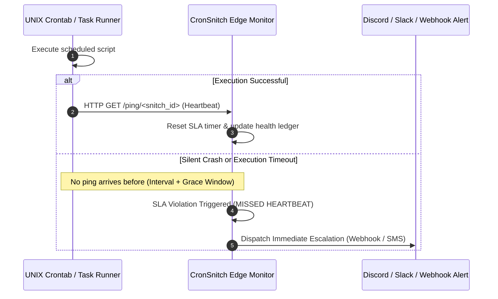

# CronSnitch: Silent Cron Failure & Dead Man's Snitch Watchdog ⚡

> **Instant Dead Man's Snitch for Developers, Solo Founders, and DevOps. Catch silent cron deaths before customers do.**

[](https://sunzzx.github.io/cron-snitch-silent-failure-detector/)
[](https://github.com/Sunzzx/cron-snitch-silent-failure-detector)
[](LICENSE)
[](https://python.org)

---

## 🚀 Live Production Web App
**[Launch CronSnitch Studio →](https://sunzzx.github.io/cron-snitch-silent-failure-detector/)**

---

## 1. Problem Statement

Standard UNIX cron, systemd timers, and background task queues fail silently:
* A missing environment variable causes a Python script to exit with code 1.
* A remote volume runs out of inodes during database backups.
* A third-party webhook provider times out, leaving transactions orphaned.

In all these cases, **cron sends no error by default**. You only discover the disaster days later when an angry customer writes to support.

Enterprise monitoring tools like Datadog or PagerDuty charge upwards of **$120/mo** for basic synthetic check-ins. **CronSnitch** provides a $0 infrastructure alternative with instant 1-line integration.

---

## 2. Architecture & Operational Flow



---

## 3. Quickstart & Integration

### A. 1-Line Crontab Integration (Zero Dependency)
Append a single `curl` ping to the end of any crontab entry:
```bash
0 * * * * /usr/local/bin/backup.sh && curl -fsS -m 10 https://cronsnitch.dev/ping/snitch_8f92a1 || curl -fsS -X POST -d '{"status":"fail"}' https://cronsnitch.dev/fail/snitch_8f92a1
```

### B. Python CLI Developer Utility
```bash
# Clone and install locally
cd ~/Developer/cron-snitch-silent-failure-detector
pip install -e .

# Wrap any command with automatic ping telemetry:
cron-snitch wrap --name "pg-backup" -- python3 backup.py

# Check status of tracked jobs:
cron-snitch status

# Assert job health within interval:
cron-snitch check "pg-backup" --interval 3600 --grace 300
```

---

## 4. Feature Comparison

| Capability | CronSnitch | Datadog Synthetic | PagerDuty |
| :--- | :---: | :---: | :---: |
| **Cost for Solo Builders** | **$0 / $29 Lifetime** | $120/month | $41/user/mo |
| **Agentless curl Support** | **Yes** | No (Custom SDK) | No |
| **Interactive Edge Simulator** | **Yes** | No | No |
| **Jitter Grace Windows** | **Yes** | Yes | Yes |
| **Open Source (MIT)** | **Yes** | No | No |

---

## 5. Verification & Testing

Run unit tests via `pytest`:
```bash
pytest tests/ -v
```

---

## License

MIT © Sunzzx
